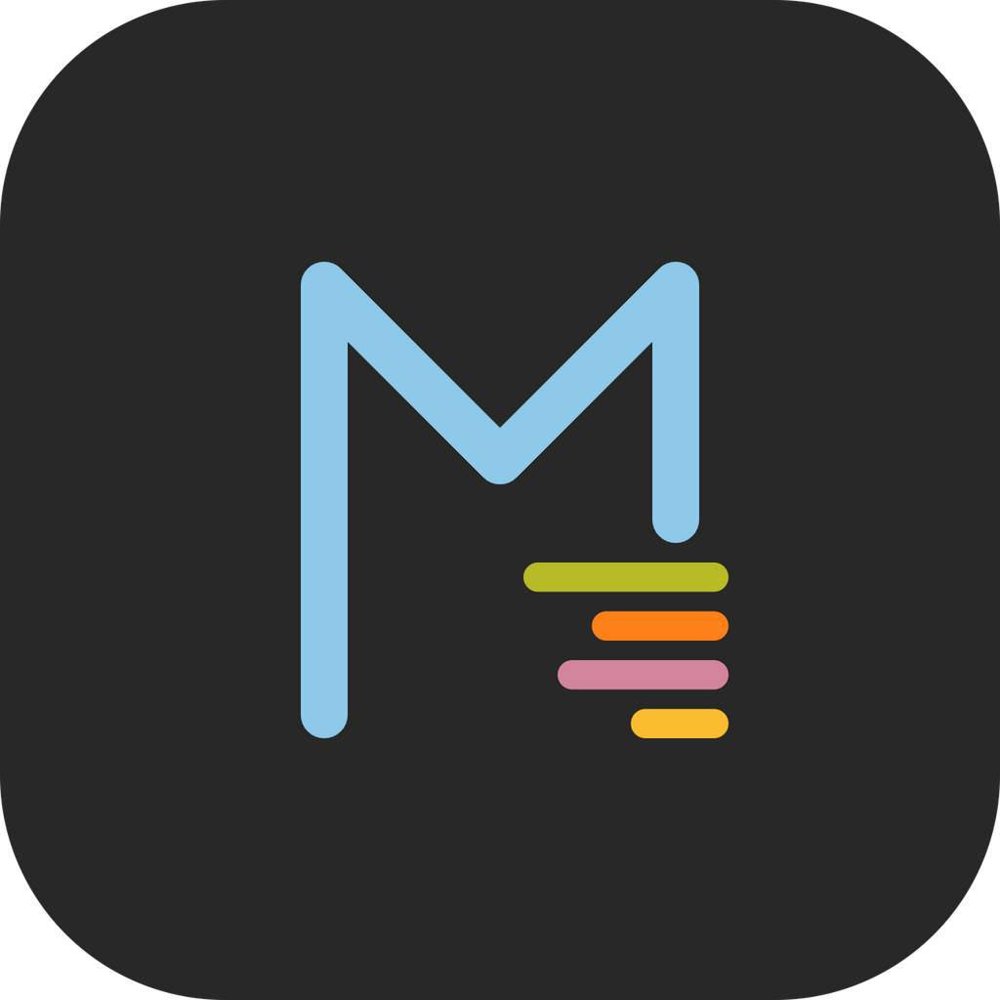
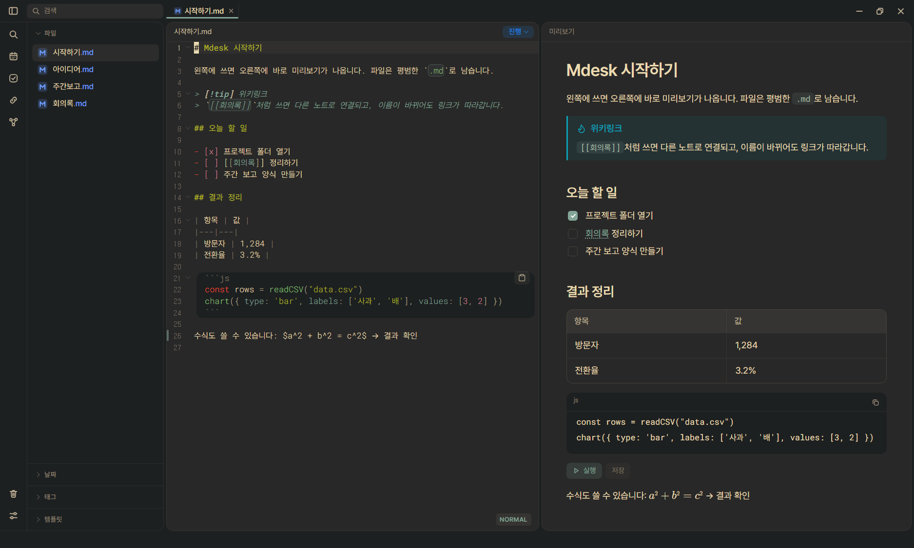
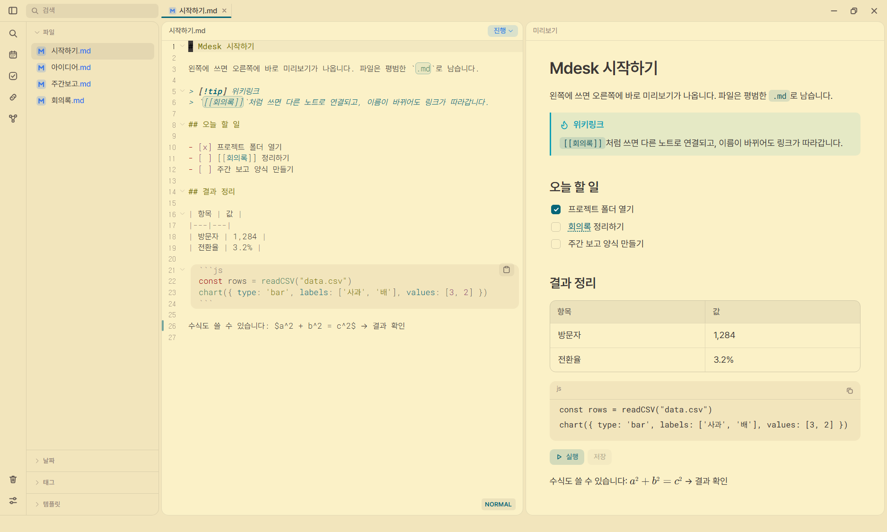

<p align="center">
  
</p>

<h1 align="center">Mdesk</h1>

<p align="center">
  Markdown 기반의 문서 작성 및 관리 애플리케이션
</p>

<p align="center">
  <a href="https://github.com/dvdsvds/MDesk/releases/latest"></a>
  
  <a href="LICENSE"></a>
</p>

<p align="center">
  
</p>

---

## 목차

1. [프로젝트 소개](#1-프로젝트-소개)
2. [주요 기능](#2-주요-기능)
3. [프로젝트 구조](#3-프로젝트-구조)
4. [개발 환경](#4-개발-환경)
5. [설치 및 빌드 방법](#5-설치-및-빌드-방법)
6. [사용 방법](#6-사용-방법)
7. [사용 예제](#7-사용-예제)
8. [개발 현황](#8-개발-현황)
9. [기타](#9-기타)
10. [라이선스](#10-라이선스)

---

## 1. 프로젝트 소개

`Mdesk`는 `Markdown`을 기반으로 문서를 작성하고 관리할 수 있는 데스크톱 애플리케이션입니다.

문서 편집 기능을 중심으로 파일 관리, 문서 간 연결, 템플릿, 코드 실행 및 다양한 문서 형식을 지원합니다.

작업 공간은 일반적인 파일 시스템을 기반으로 구성되며, 모든 문서는 표준 `Markdown` 파일로 저장됩니다. 따라서 별도의 전용 데이터베이스에 종속되지 않고 외부 편집기나 도구와 함께 사용할 수 있습니다.

이 문서에서 사용하는 용어는 다음과 같습니다.

| 용어 | 의미 |
|---|---|
| 작업 공간 | Mdesk가 관리하는 최상위 디렉터리입니다. 모든 문서와 첨부 파일이 이 디렉터리 아래에 저장됩니다. |
| 문서 | 작업 공간에 저장된 `Markdown`(`.md`) 파일입니다. 화면에서는 `노트`로 표시되는 경우도 있습니다. |
| 파일 | 문서를 포함한 모든 파일입니다. 이미지, PDF, CSV 등 `Markdown`이 아닌 파일을 가리킬 때 사용합니다. |
| 템플릿 | 자주 쓰는 문서 구조를 저장해 두고, 새 문서를 만들거나 기존 문서에 삽입할 때 쓰는 틀입니다. `{{date}}` 같은 변수를 사용할 수 있습니다. |
| 문서 양식 | 문서 안에 `template [ ... ]` 블록으로 작성하는 영수증·보고서 같은 정형 문서입니다. 템플릿과는 별개의 기능입니다. |

---

## 2. 주요 기능

### 문서 작성 및 편집

- Vim 키 바인딩 지원
- 서식 툴바와 `/` 메뉴를 통한 블록 삽입
- 괄호, 강조 기호, 백틱 자동 완성 및 목록 번호 자동 정리
- 자동 저장 및 비정상 종료 후 미저장 내용 복구
- 파일별 버전 기록 비교 및 이전 버전 복원

### Markdown 지원

- CommonMark 및 GFM 지원: 표, 체크리스트, 취소선, 각주
- 수식 렌더링: KaTeX를 이용한 인라인 및 블록 수식
- Mermaid 코드 블록을 이용한 다이어그램 생성
- 콜아웃 문법 지원: `> [!tip] 제목`
- 아코디언 문법 지원: `[>] 제목` 아래에 들여쓴 내용이 접힌 채로 표시됩니다. 내용에는 목록, 코드, 다른 아코디언을 넣을 수 있습니다.
- 체크리스트 연동: 상위 항목을 체크하면 들여쓴 하위 항목이 모두 체크되고, 하위 항목이 모두 체크되면 상위 항목이 자동으로 체크됩니다.
- 사용자 지정 글자색 지원: `{red|빨간 글자}`, `{#980000|진한 빨강}`

### 문서 관리

- 실제 파일 시스템을 기반으로 작업 공간 구성 및 중첩 디렉터리 제한 없이 사용
- 여러 문서를 탭으로 열 수 있으며, 애플리케이션 재실행 시 이전 탭 복원
- 빠른 검색(`Ctrl+P`) 및 문서 본문 전체 검색
- 위키링크 지원: `[[노트]]`, `[[노트#제목]]`, `[[노트|별칭]]`
- 위키링크 대상 자동완성 및 파일 이름 · 경로 변경 시 참조 링크 자동 갱신
- 백링크 패널 및 문서 간 연결 관계를 시각화하는 그래프 보기
- 문서 및 이미지 임베드 지원: `![[...]]`
- 문서별 상태 지정(**대기 · 진행 · 보류 · 완료**) 및 상태별 모아 보기
- 템플릿을 이용한 문서 생성 및 날짜별 문서 모아 보기
- 삭제한 문서를 작업 공간의 `.mdesk/trash/`에 보관하고 30일 후 자동 삭제
- 사이드바에서 `Ctrl+Z`를 사용하여 삭제한 문서 복원

### 이미지 및 첨부 파일 관리

- 이미지 붙여넣기 및 드래그 앤 드롭 지원
- 추가한 이미지를 동일한 디렉터리의 `img/`에 저장하고 문서에 링크 자동 삽입
- **PDF**, **Excel** 등의 첨부 파일을 `files/`에 저장
- 이미지 및 PDF 파일의 애플리케이션 내 미리보기 지원

### 생산성 도구

- **할 일 (`Ctrl+Shift+T`)**: 작업 공간 내 모든 문서의 체크리스트 항목을 통합 관리
- **퀵 캡처 (`Ctrl+Alt+N`)**: 애플리케이션 외부에서도 단축키를 사용하여 `Inbox.md`에 메모 추가
- **목차 패널 (`Ctrl+Shift+O`)**: 문서의 제목 구조를 확인하고 원하는 위치로 이동

### 다양한 파일 형식 지원

- 텍스트 및 코드 파일 열기와 언어별 구문 강조
- CSV 파일의 열별 색상 구분 및 구분자 자동 감지
- CSV 열 너비 조정 기능 제공 (화면 표시만 변경하며 원본 파일은 수정하지 않음)
- DOCX 및 XLSX 파일의 읽기 전용 미리보기
- 파일 형식별 아이콘 표시

### 화면 및 환경 설정

- 색 테마 17종 선택: Paper 4종(Light, Dark, Warm Light, Warm Dark)과 Gruvbox, Tokyo Night, Catppuccin, Nord, Dracula, Solarized, One Dark, Rosé Pine. 설정에서 미리보기를 보며 고를 수 있고, 처음 실행할 때 한 번 묻습니다 ([출처](#색-테마-출처))
- 에디터와 미리보기의 글꼴, 글자 크기, 줄 간격 개별 설정
- 한글과 영문의 글자 폭을 일정하게 유지하는 고정폭 글꼴 제공: Monoplex KR, D2Coding, 나눔고딕코딩
- 단축키 사용자 지정 및 설정의 정보 탭에서 애플리케이션 버전과 실행 환경 확인
- 화면 확대 · 축소 및 초기화 지원 (`Ctrl+=`, `Ctrl+-`, `Ctrl+0`)

<p align="center">
  
</p>

---

## 3. 프로젝트 구조

```text
src/
├─ main/            Electron 메인 프로세스: 파일 입출력, 작업 공간 감시, 휴지통, 퀵 캡처, 코드 실행, 업데이트 관리
├─ preload/         렌더러 프로세스에 안전하게 노출하는 API
└─ renderer/src/
   ├─ editor/       CodeMirror 에디터 확장: Vim, 자동 닫기, 접기, 선택 및 커서, 문법 강조
   ├─ markdown/     markdown-it 확장 규칙: 위키링크, 콜아웃, 아코디언, 임베드, 글자색
   ├─ features/     주요 기능: 사이드바, 미리보기, 설정, 문서 양식, 내보내기
   ├─ components/   공용 UI 컴포넌트
   ├─ stores/       Zustand 기반 상태 관리: 설정, 탭 등
   ├─ js/, python/  JavaScript 및 Python 코드 실행 환경
   └─ assets/       테마 색상(theme.css) 및 스타일 리소스

build/              애플리케이션 아이콘 및 빌드 리소스
docs/               README 문서용 화면 캡처
patches/            의존성 패치 (patch-package)
scripts/            아이콘 생성, Pyodide 복사 등 보조 스크립트
```

각 영역은 메인 프로세스와 렌더러 프로세스로 분리되어 있으며, 두 프로세스는 `preload`가 노출하는 API를 통해서만 통신합니다.

---

## 4. 개발 환경

| 영역 | 사용 기술 |
|---|---|
| 애플리케이션 프레임워크 | Electron 39, electron-vite, electron-builder, electron-updater |
| 사용자 인터페이스 | React 19, TypeScript 5, Tailwind CSS 4, Zustand, Motion |
| 코드 에디터 | CodeMirror 6, `@replit/codemirror-vim` (Vim 키 바인딩), `@codemirror/lang-markdown` |
| 마크다운 처리 | markdown-it (각주, 체크리스트), KaTeX (수식), Mermaid (도표), DOMPurify |
| 파일 미리보기 | pdf.js (PDF), docx-preview (DOCX), ExcelJS (XLSX) |
| 코드 실행 | JavaScript 격리 실행 환경, Pyodide (Python) |
| 글꼴 | Pretendard, Roboto Mono, Monoplex KR, D2Coding, 나눔고딕코딩 ([출처](#글꼴-출처)) |
| 빌드 및 코드 검사 | Vite 7, ESLint, Prettier, GitHub Actions (Windows, macOS, Linux 빌드 및 릴리스) |

개발에는 Node.js 20 이상과 npm이 필요합니다.

애플리케이션 아이콘의 원본 파일은 [`build/icon.svg`](build/icon.svg)입니다. 다음 명령을 실행하면 PNG, ICO, ICNS 형식의 아이콘을 생성할 수 있습니다.

```bash
npx electron scripts/make-icons.mjs
```

---

## 5. 설치 및 빌드 방법

### 설치

Mdesk는 Windows, macOS, Linux 환경을 지원합니다.

[Releases](https://github.com/dvdsvds/MDesk/releases)에서 최신 버전을 확인하고 운영체제에 맞는 설치 파일을 다운로드합니다.

#### Windows

1. `mdesk-x.y.z-setup.exe`를 다운로드합니다.
2. 다운로드한 설치 파일을 실행하여 설치를 진행합니다.
3. `Windows SmartScreen` 경고가 표시되면 **추가 정보 → 실행**을 선택합니다.

#### macOS

1. `mdesk-x.y.z.dmg`를 다운로드합니다.
2. DMG 파일을 열고 Mdesk를 **응용 프로그램** 폴더로 이동합니다.
3. 처음 실행할 때 확인되지 않은 개발자에 관한 경고가 표시되면 터미널에서 다음 명령을 실행한 후 다시 실행합니다.

```bash
xattr -cr /Applications/Mdesk.app
```

위 명령은 Mdesk 앱 번들 내부의 확장 속성을 재귀적으로 제거합니다. 다운로드한 애플리케이션에 부여된 격리 속성(`com.apple.quarantine`)도 제거되어 macOS의 실행 제한이 해제될 수 있습니다.

**주의**: 이 명령은 격리 속성만 제거하는 것이 아니라 앱 번들 내부의 모든 확장 속성을 제거합니다. 공식 GitHub Releases에서 다운로드한 파일인지 확인한 후 실행해야 합니다.

#### Linux

**AppImage**

```bash
chmod u+x mdesk-x.y.z.AppImage
./mdesk-x.y.z.AppImage
```

**deb (Ubuntu, Debian)**

```bash
sudo apt install ./mdesk_x.y.z_amd64.deb
```

#### 기타 다운로드 파일

`latest*.yml`, `*.blockmap`, `*.zip` 파일은 자동 업데이트에 사용됩니다. 일반적인 설치에는 필요하지 않습니다.

#### 업데이트

| 운영체제 | 업데이트 방법 |
|---|---|
| Windows | 새 버전이 배포되면 애플리케이션이 자동으로 업데이트합니다. |
| Linux (AppImage) | 새 버전이 배포되면 애플리케이션이 자동으로 업데이트합니다. |
| Linux (deb) | Releases에서 새 버전을 다운로드하여 다시 설치합니다. |
| macOS | Releases에서 새 버전을 다운로드하여 다시 설치합니다. 현재 코드 서명이 적용되지 않아 자동 업데이트를 지원하지 않습니다. |

자동 업데이트는 애플리케이션을 실행할 때와 실행 중 4시간마다 새 버전을 확인합니다. 새 버전이 있으면 화면 왼쪽 아래에 받는 중이라는 알림이 나타나고 진행률이 막대로 표시됩니다. 다운로드가 끝나면 알림이 **재시작** 버튼으로 바뀌며, 버튼을 누르면 바로 설치하고 다시 실행합니다. 버튼을 누르지 않고 애플리케이션을 종료해도 그 시점에 설치됩니다. 저장하지 않은 변경 사항이 있으면 재시작 전에 저장 여부를 먼저 묻습니다.

업데이트 후 처음 실행하면 변경 내용이 `Markdown` 형식 그대로 정리되어 나타납니다.

### 소스 빌드

다음 명령을 실행하여 소스 코드를 받고 개발 모드로 실행합니다.

```bash
git clone https://github.com/dvdsvds/MDesk.git
cd MDesk
npm install          # 의존성 설치, 패치 적용, Pyodide 복사
npm run dev          # 개발 모드 실행
```

다음 명령을 실행하여 설치 파일을 생성합니다.

```bash
npm run build:win    # Windows
npm run build:mac    # macOS (macOS에서만)
npm run build:linux  # Linux
```

결과물은 `dist/`에 생성됩니다. `v*` 태그를 푸시하면 GitHub Actions가 세 운영체제의 설치 파일을 빌드하여 릴리스에 업로드합니다.

---

## 6. 사용 방법

### 시작하기

1. Mdesk를 처음 실행하면 애플리케이션 데이터 디렉터리에 전용 작업 공간이 생성됩니다. 해당 폴더가 기본 작업 공간으로 설정되며, 위치는 설정에서 변경할 수 있습니다.
2. 왼쪽 사이드바에서 **새 파일**을 선택하거나 `Ctrl+N`을 눌러 새 문서를 생성합니다. 문서 이름을 입력하면 해당 이름으로 파일이 생성됩니다.
3. 에디터에서 작성한 내용은 오른쪽 미리보기 패널에 실시간으로 반영됩니다.
4. 문서의 변경 사항은 입력을 멈추면 자동으로 저장됩니다. `Ctrl+S`를 사용하여 수동으로 저장할 수도 있습니다.

작업 공간은 일반 파일 시스템을 기반으로 합니다. 따라서 파일 탐색기나 외부 편집기에서 변경한 내용도 Mdesk에 자동으로 반영됩니다.

### 단축키

macOS에서는 `Ctrl` 키 대신 `Cmd` 키를 사용합니다. 모든 단축키는 설정에서 변경할 수 있습니다.

#### 파일 및 편집

| 기능 | 단축키 |
|---|---|
| 새 파일 | `Ctrl+N` |
| 저장 | `Ctrl+S` |
| 퀵 캡처 | `Ctrl+Alt+N` |
| 새 폴더 | `Ctrl+Shift+N` |
| 이름 바꾸기 | `F2` |
| 되돌리기 | `Ctrl+Z` |

#### 검색 및 탐색

| 기능 | 단축키 |
|---|---|
| 빠른 검색 | `Ctrl+P` |
| 목차 패널 | `Ctrl+Shift+O` |
| 백링크 패널 | `Ctrl+Shift+B` |
| 그래프 보기 | `Ctrl+Shift+G` |
| 절대 경로 복사 | `Ctrl+Shift+C` |
| 상대 경로 복사 | `Ctrl+Alt+C` |
| 탐색기에서 보기 | `Ctrl+Alt+R` |

#### 패널 및 화면

| 기능 | 단축키 |
|---|---|
| 할 일 | `Ctrl+Shift+T` |
| 사이드바 | `Ctrl+Shift+E` |
| 에디터 / 분할 / 미리보기 | `Ctrl+Alt+I` / `Ctrl+Alt+O` / `Ctrl+Alt+P` |
| 화면 확대 / 축소 / 초기화 | `Ctrl+=` / `Ctrl+-` / `Ctrl+0` |

#### 기타

| 기능 | 단축키 |
|---|---|
| 설정 | `Ctrl+,` |
| 내보내기 | `Ctrl+Alt+E` |

---

## 7. 사용 예제

### 문서 템플릿

자주 사용하는 문서 구조를 템플릿으로 저장하고, 새 문서를 생성하거나 기존 문서에 삽입할 수 있습니다. 템플릿은 작업 공간이 아닌 애플리케이션 설정에 저장됩니다.

#### 템플릿 생성 및 관리

1. 왼쪽 사이드바의 **템플릿** 섹션에서 **+ 템플릿 추가**를 선택합니다.
2. 템플릿 이름과 내용을 입력한 후 **저장**을 선택합니다.
3. 템플릿 목록에서 이름을 선택하면 내용을 편집할 수 있습니다. 마우스 오른쪽 버튼을 클릭하면 편집 및 삭제 메뉴가 표시됩니다.

#### 템플릿 적용

- **넣기** 또는 우클릭 메뉴의 **지금 노트에 넣기**: 현재 열려 있는 문서의 커서 위치에 템플릿 내용을 삽입합니다.
- 우클릭 메뉴의 **이 템플릿으로 새 노트**: 템플릿 이름으로 새 문서를 생성하고 내용을 적용합니다. 동일한 이름의 문서가 이미 존재하면 `회의록 2`와 같이 번호를 추가합니다.

#### 템플릿 변수

템플릿 내용에 다음 변수를 사용하면 템플릿을 적용하는 시점에 해당 값으로 치환됩니다.

| 변수 | 치환 값 |
|---|---|
| `{{date}}` | 현재 날짜 (기본 형식 `2026-11-12`) |
| `{{time}}` | 현재 시각 (`14:30`) |
| `{{title}}` | 문서 파일 이름 (확장자 제외) |
| `{{yesterday}}` | 전날 날짜 |
| `{{tomorrow}}` | 다음 날 날짜 |

날짜 변수(`{{date}}`, `{{yesterday}}`, `{{tomorrow}}`)는 `{{date:YYYY년 M월 D일 dddd}}`와 같이 콜론 뒤에 날짜 형식을 지정할 수 있습니다.

| 형식 | 설명 | 예시 |
|---|---|---|
| `YYYY` / `YY` | 연도 | 2026 / 26 |
| `MM` / `M` | 월 | 11 / 11 |
| `DD` / `D` | 일 | 05 / 5 |
| `ddd` | 요일 (축약형) | 목 |
| `dddd` | 요일 | 목요일 |

표에 명시되지 않은 문자는 별도의 변환 없이 그대로 출력됩니다.

#### 템플릿 예시

```markdown
# {{title}}

- 날짜: {{date}} {{time}}
- 참석자:

## 안건

- 

## 결정사항

1. 

## 할 일

- [ ] 
```

### 문서 양식

`template [ ... ]` 블록을 사용하여 영수증, 보고서 등 정형화된 문서 양식을 작성할 수 있습니다.

미리보기에서 **편집**을 선택하면 표의 셀을 직접 편집할 수 있으며, 완성된 문서는 PDF로 내보낼 수 있습니다.

#### 작성 예시

다음은 상호와 날짜를 표시하는 영수증 양식입니다.

```
value [
  상호: 가나다상회
  날짜: 2026-10-14
]

template [
  page A4
  title : 영수증
  table col=2 row=2 widths=40,- frame=double [
    col=1 row=1 bold [
      text center : 상호
    ]
    col=2 row=1 [
      text : {{상호}}
    ]
    col=1 row=2 bold [
      text center : 날짜
    ]
    col=2 row=2 [
      text : {{날짜}}
    ]
  ]
  text right : 위 금액을 정히 영수합니다.
]
```

#### 문법

| 문법 | 설명 |
|---|---|
| `value [ 이름: 값 ]` | 양식에서 사용할 변수와 값을 정의합니다. |
| `page A4` | 문서의 페이지 크기를 지정합니다. |
| `title : 글자` | 제목을 표시합니다. 기본적으로 가운데 정렬, 굵게, 16px가 적용됩니다. |
| `text 옵션 : 글자` | 텍스트 한 줄을 표시합니다. `text :`는 빈 줄을 생성합니다. |
| `table col=열 row=행 [ ]` | 지정한 행과 열로 표를 생성합니다. `widths=`로 열 너비(mm)를 지정하며, `-`는 나머지 너비를 사용합니다. `frame=`으로 테두리 스타일을 지정합니다. |
| `col=1-2 row=3 [ ]` | 표의 셀 위치와 범위를 지정합니다. 셀 내부에는 `text` 등을 사용하여 내용을 구성합니다. |
| `line` | 구분선을 표시합니다. |
| `space` | 빈 공간을 추가합니다. |
| `box [ ]` | 테두리가 있는 영역을 생성합니다. |
| `chart [ ]` | 차트를 표시합니다. |

#### 스타일 옵션

| 옵션 | 설명 |
|---|---|
| `left`, `center`, `right` | 가로 정렬 |
| `top`, `middle`, `bottom` | 세로 정렬 |
| `bold` | 굵게 표시 |
| `italic` | 기울임꼴 적용 |
| `underline` | 밑줄 적용 |
| `strike` | 취소선 적용 |
| `fs=12` | 글자 크기 지정 |
| `fc=red` | 글자색 지정 |
| `bg=yellow` | 배경색 지정 |

#### 편집 기능

미리보기의 편집 모드에서는 다음 작업을 수행할 수 있습니다.

- 셀을 선택하여 내용을 편집하고 변경 사항을 원본 문법에 즉시 반영
- 여러 셀을 선택하여 병합하거나 분할
- 표의 행과 열 추가 및 삭제
- 열 경계를 드래그하여 너비 조정
- 툴바를 사용하여 글꼴, 크기, 굵기, 색상, 정렬 및 위·아래 첨자 설정

### 코드 실행

JavaScript와 Python 코드 블록을 실행할 수 있습니다. 코드 블록에 표시되는 **실행** 버튼을 선택하면 코드가 실행되며, 실행 결과는 해당 코드 블록 아래에 표시됩니다.

실행 결과는 자동으로 문서에 저장되지 않습니다. 결과를 문서에 기록하려면 **저장** 버튼을 선택해야 합니다. 저장된 결과는 문서에 포함되어 이후에도 확인할 수 있습니다.

```js
const rows = readCSV("data.csv")
table(rows)
chart({ type: 'bar', labels: ['사과', '배'], values: [3, 2] })
```

```py
print(sum(range(10)))
```

#### 지원 기능

- `table(rows)`: 데이터를 표 형태로 출력합니다.
- `chart({ type, labels, values })`: 막대(`bar`), 선(`line`), 파이(`pie`) 차트로 시각화합니다.
- `readFile`, `readJSON`, `readCSV`: 작업 공간 내 파일을 읽습니다. 지원 형식은 CSV, TSV, JSON, TXT, MD이며 파일 크기는 각각 2MB 이하로 제한됩니다.

코드는 격리된 실행 환경에서 처리됩니다. 해당 환경에서는 파일 쓰기 및 인터넷 접속이 차단됩니다.

---

## 8. 개발 현황

### 구현 완료

- Markdown 편집, 실시간 미리보기, Vim 키 바인딩
- 위키링크, 백링크, 그래프 보기, 임베드, 콜아웃
- 상태 지정, 템플릿, 날짜별 모아 보기, 할 일 통합 관리, 퀵 캡처
- 애플리케이션 전용 휴지통 및 삭제 문서 복원
- 이미지·PDF·DOCX·XLSX 미리보기, CSV 열별 색상 구분
- JavaScript 및 Python 코드 실행
- 문서 양식 작성 및 PDF 내보내기
- 색 테마 17종 선택, 단축키 사용자 지정
- Windows, macOS, Linux 빌드 및 자동 업데이트(진행률 표시와 재시작 안내)

### 개발 예정

- 표 보기, 보드 보기, 캘린더 보기
- DOCX 및 XLSX 편집
- 템플릿 슬래시(`/`) 메뉴 삽입
- 블록 링크 및 블록 임베드
- 대용량 텍스트 파일 및 바이너리 파일 뷰어

### 검토 중

- 플러그인, 동기화, 모바일 지원, 캔버스

개발 예정 및 검토 중인 기능은 우선순위와 일정이 변경될 수 있습니다.

---

## 9. 기타

### 사용 시 참고 사항

**설치할 때 보안 경고가 표시됩니다**

코드 서명 인증서가 없어서 표시되는 경고입니다. Windows는 **추가 정보 → 실행**, macOS는 위의 `xattr -cr` 명령으로 열 수 있습니다.

**내 파일은 어디에 있습니까**

작업 공간에 일반 `.md` 파일로 저장됩니다. 작업 공간은 설정에서 확인하고 변경할 수 있으며, 애플리케이션을 제거해도 문서 파일은 삭제되지 않습니다.

**다른 편집기와 같이 써도 됩니까**

사용할 수 있습니다. 외부에서 수정한 내용은 자동으로 반영되며, Mdesk에 저장하지 않은 내용이 있으면 두 버전의 차이를 비교하여 표시하고, 유지할 버전을 선택할 수 있습니다.

**macOS에서 업데이트 알림이 오지 않습니다**

코드 서명이 없는 macOS 애플리케이션은 자동 업데이트를 지원하지 않습니다. Releases에서 새 버전을 직접 받아 주십시오.

### 이슈 및 피드백

버그 신고와 기능 제안, 디자인 및 사용성에 대한 의견을 환영합니다. 의견은 [Issues](https://github.com/dvdsvds/MDesk/issues)에 남겨 주십시오.

### 글꼴 출처

앱에는 아래 글꼴이 들어 있습니다. 모두 글꼴 파일을 수정하지 않고 그대로 사용하며, Monoplex KR만 용량을 줄이기 위해 TTF를 WOFF2로 변환했습니다. 각 글꼴의 라이선스 원문은 [`src/renderer/src/assets/fonts`](src/renderer/src/assets/fonts) 아래 해당 폴더에 있습니다.

| 글꼴 | 만든 곳 | 라이선스 | 출처 | 쓰이는 곳 |
|---|---|---|---|---|
| Monoplex KR 1.3.0 | Kim Yangsu (IBM Plex Mono와 IBM Plex Sans KR을 합침) | SIL OFL 1.1 | [y-kim/monoplex](https://github.com/y-kim/monoplex) | 에디터 (기본) |
| D2Coding | NAVER Corporation | SIL OFL 1.1 | [naver/d2codingfont](https://github.com/naver/d2codingfont) | 에디터 |
| 나눔고딕코딩 | NHN Corporation, 디자인 Sandoll Communications | SIL OFL 1.1 | [Fontsource](https://fontsource.org/fonts/nanum-gothic-coding) | 에디터 |
| Roboto Mono | Google, Christian Robertson | Apache 2.0 | [Fontsource](https://fontsource.org/fonts/roboto-mono) | 에디터 (영문 대체) |
| Pretendard | Kil Hyung-jin | SIL OFL 1.1 | [orioncactus/pretendard](https://github.com/orioncactus/pretendard) | 화면, 미리보기 |

Monoplex KR, D2Coding, 나눔고딕코딩은 한글 한 글자의 폭이 영문 한 글자의 정확히 두 배이므로, 표의 `|` 위치가 모든 행에서 정렬됩니다.

### 색 테마 출처

Paper 계열 4종은 MarkRoom이 직접 만든 색입니다. 나머지 테마는 아래 팔레트의 색을 이 앱의 화면에 맞게 옮긴 것이며, 각 프로젝트의 공식 배포물이 아닙니다. 팔레트 이름과 색의 저작권은 각 제작자에게 있습니다.

| 테마 | 만든 곳 | 라이선스 | 출처 |
|---|---|---|---|
| Gruvbox Light, Dark | Pavel Pertsev | MIT/X11 | [morhetz/gruvbox](https://github.com/morhetz/gruvbox) |
| Tokyo Night, Tokyo Night Light | enkia | MIT | [enkia/tokyo-night-vscode-theme](https://github.com/enkia/tokyo-night-vscode-theme) |
| Catppuccin Latte, Mocha | Catppuccin | MIT | [catppuccin/catppuccin](https://github.com/catppuccin/catppuccin) |
| Nord | Arctic Ice Studio | MIT | [nordtheme/nord](https://github.com/nordtheme/nord) |
| Dracula | Dracula Theme | MIT | [dracula/dracula-theme](https://github.com/dracula/dracula-theme) |
| Solarized Light, Dark | Ethan Schoonover | MIT | [altercation/solarized](https://github.com/altercation/solarized) |
| One Dark | Atom | MIT | [atom/atom](https://github.com/atom/atom) |
| Rosé Pine, Rosé Pine Dawn | Rosé Pine | MIT | [rose-pine/rose-pine-theme](https://github.com/rose-pine/rose-pine-theme) |

---

## 10. 라이선스

[MIT](LICENSE)
