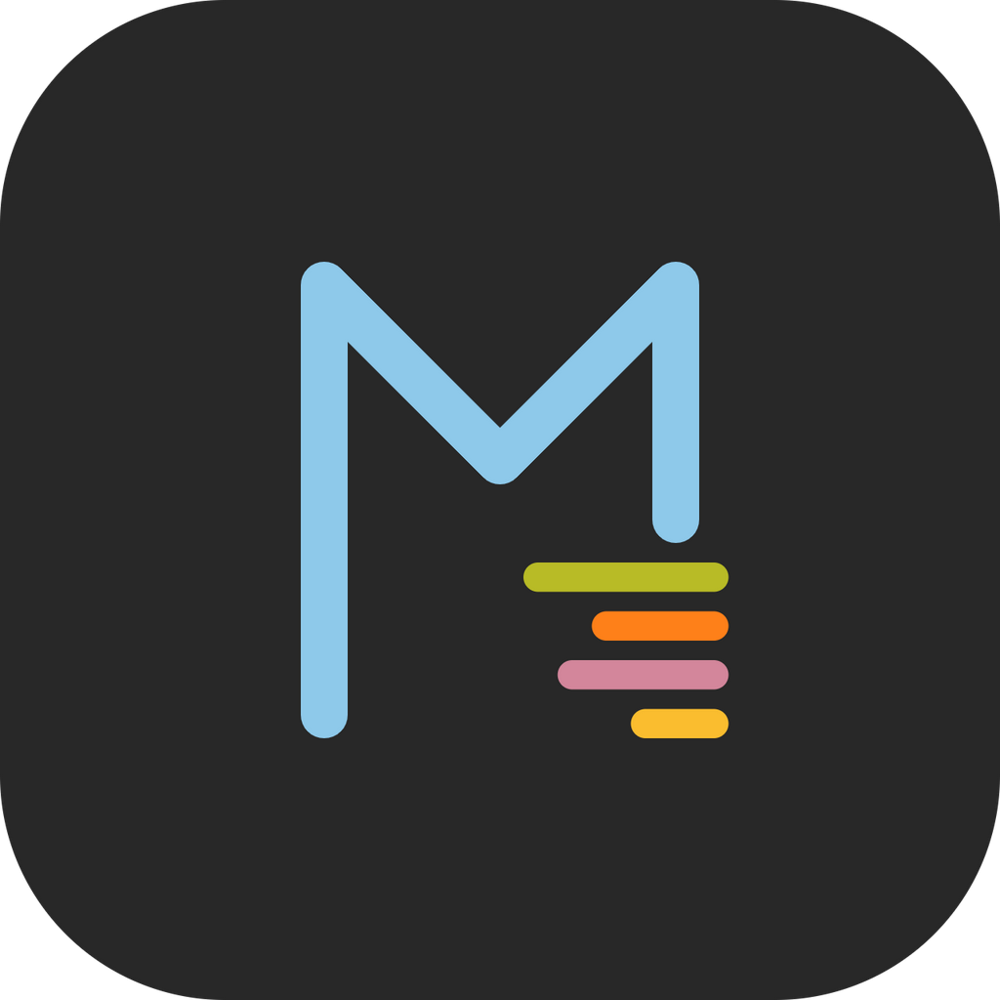
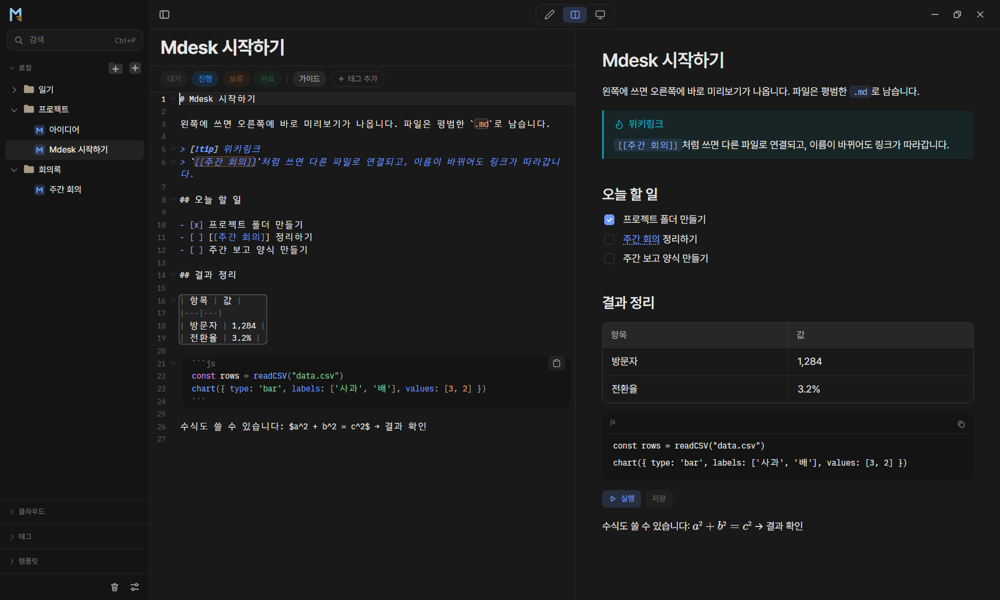
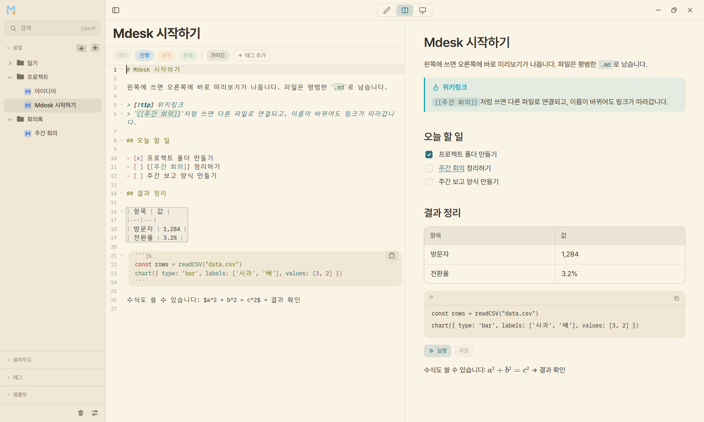

<p align="center">
  
</p>

<h1 align="center">Mdesk</h1>

<p align="center">
  Markdown 기반의 문서 작성 및 관리 애플리케이션
</p>

<p align="center">
  <a href="https://github.com/dvdsvds/MDesk/releases/latest"></a>
  
  <a href="LICENSE"></a>
</p>

<p align="center">
  
</p>

---

## 목차

1. [프로젝트 소개](#1-프로젝트-소개)
2. [주요 기능](#2-주요-기능)
3. [프로젝트 구조](#3-프로젝트-구조)
4. [개발 환경](#4-개발-환경)
5. [설치 및 빌드 방법](#5-설치-및-빌드-방법)
6. [사용 방법](#6-사용-방법)
7. [사용 예제](#7-사용-예제)
8. [개발 현황](#8-개발-현황)
9. [기타](#9-기타)
10. [라이선스](#10-라이선스)

---

## 1. 프로젝트 소개

`Mdesk`는 `Markdown` 문서를 작성하고 관리하는 데스크톱 애플리케이션입니다.

문서 편집을 중심으로 파일 관리, 문서 간 연결, 템플릿, 코드 실행, 다양한 파일 형식을 지원합니다.

모든 문서는 일반 폴더에 표준 `Markdown` 파일로 저장됩니다. 전용 데이터베이스를 사용하지 않으므로 다른 편집기나 도구와 함께 사용할 수 있습니다.

이 문서에서 사용하는 용어는 다음과 같습니다.

| 용어 | 의미 |
|---|---|
| 작업 공간 | Mdesk가 관리하는 최상위 폴더입니다. 모든 문서와 첨부 파일이 이 폴더 아래에 저장됩니다. |
| 문서 | 작업 공간에 저장된 `Markdown`(`.md`) 파일입니다. |
| 파일 | 문서를 포함한 모든 파일입니다. 이미지, PDF, CSV 등을 가리킬 때도 사용합니다. |
| 템플릿 | 새 문서를 만들거나 기존 문서에 삽입할 때 사용하는 문서 틀입니다. `{{date}}` 등의 변수를 사용할 수 있습니다. |
| 문서 양식 | 문서 안에 `template [ ... ]` 블록으로 작성하는 영수증, 보고서 등의 정형 문서입니다. 템플릿과는 다른 기능입니다. |

---

## 2. 주요 기능

### 문서 작성 및 편집

- Vim 키 바인딩 지원 (마우스 클릭과 드래그도 사용 가능)
- 서식 툴바와 `/` 메뉴를 통한 블록 삽입
- 괄호, 강조 기호, 백틱 자동 완성
- 번호 목록 자동 정리: 항목을 삭제하면 번호를 다시 매기고, 빈 항목에서 `Enter`를 누르면 기호를 삭제합니다.
- 표 편집 보조
  - 헤더 행을 `|`로 닫으면 구분선과 빈 행을 자동으로 추가합니다.
  - `Tab`으로 다음 칸으로 이동하며, 마지막 칸에서는 새 열을 추가합니다.
  - `Enter`로 다음 행의 첫 칸으로 이동하며, 빈 마지막 행에서는 표를 벗어납니다.
  - 빈 행의 바깥쪽 `|`를 삭제하면 행이 삭제되고, 헤더의 열을 삭제하면 모든 행에서 해당 열이 삭제됩니다.
- 자동 저장(설정에서 사용) 및 비정상 종료 후 저장하지 않은 내용 복구
- 스냅샷: 저장할 때마다 이전 내용을 보관하며, 비교한 뒤 이전 내용으로 되돌릴 수 있습니다.

### Markdown 지원

- CommonMark 및 GFM 지원: 표, 체크리스트, 취소선, 각주
- 문서에 작성한 HTML은 실행하지 않고 텍스트로 표시합니다. 렌더링 결과는 DOMPurify로 정제하며 콘텐츠 보안 정책(CSP)을 적용합니다.
- KaTeX 기반 인라인 및 블록 수식
- Mermaid 코드 블록 기반 다이어그램
- 콜아웃: `> [!tip] 제목`
- 아코디언: `[>] 제목` 아래에 들여쓴 내용을 접힌 상태로 표시합니다. 목록, 코드, 다른 아코디언을 포함할 수 있습니다.
- 체크리스트 연동: 상위 항목을 체크하면 하위 항목이 모두 체크되고, 하위 항목이 모두 체크되면 상위 항목도 체크됩니다.
- 글자색 지정: `{red|빨간 글자}`, `{#980000|진한 빨강}`

### 문서 관리

- 사이드바에서 폴더와 문서를 하나의 트리로 표시하며, 폴더 깊이에 제한이 없습니다.
- 빠른 검색(`Ctrl+P`) 및 본문 전체 검색
- 위키링크: `[[문서]]`, `[[문서#제목]]`, `[[문서|별칭]]`
- 위키링크 대상 자동 완성, 파일 이름 및 경로 변경 시 링크 자동 갱신
- 문서 및 이미지 임베드: `![[...]]`
- 문서별 상태(**대기**, **진행**, **보류**, **완료**)와 태그 지정, 상태별 모아 보기
- 템플릿을 이용한 문서 생성
- 삭제한 문서는 작업 공간의 `.mdesk/trash/`에 보관하며 30일 후 자동으로 삭제합니다.
- 사이드바에서 `Ctrl+Z`로 삭제한 문서 복원

### 클라우드 (Google Drive)

- 설정의 **저장** 탭에서 Google 계정을 연결합니다. 로그인 정보는 운영체제의 보안 저장소로 암호화하여 이 기기에만 보관합니다.
- 사이드바의 **클라우드**에서 Drive의 `Mdesk` 폴더를 열고, 파일과 폴더를 생성, 이름 변경, 삭제할 수 있습니다. 삭제한 항목은 Drive 휴지통으로 이동합니다.
- Drive 파일은 임시 사본으로 열리며, 저장하면 Drive에 자동으로 업로드됩니다. 로컬 작업 공간과는 분리되어 있습니다.
- 같은 Google 계정으로 연결하면 Windows, macOS, Linux에서 같은 파일을 이어서 작성할 수 있습니다.
- 다른 기기에서 먼저 수정한 파일을 저장하면 덮어쓰지 않고 `충돌` 사본으로 업로드한 뒤 알림을 표시합니다.
- Mdesk가 만든 파일에만 접근하는 최소 권한(`drive.file`)을 사용합니다.

### 이미지 및 첨부 파일

- 이미지 붙여넣기 및 드래그 앤 드롭
- 추가한 이미지는 문서와 같은 폴더의 `img/`에 저장하고 링크를 자동으로 삽입합니다.
- **PDF**, **Excel** 등의 첨부 파일은 `files/`에 저장합니다.
- 이미지 및 PDF 미리보기

### 생산성 도구

- **목차 패널 (`Ctrl+Shift+O`)**: 문서의 제목 구조를 확인하고 해당 위치로 이동합니다.

### 다양한 파일 형식

- 텍스트 및 코드 파일의 언어별 구문 강조
- CSV 파일의 열별 색상 구분 및 구분자 자동 감지
- CSV 열 너비 조정 (화면 표시만 변경하며 원본 파일은 수정하지 않음)
- DOCX 및 XLSX 파일의 읽기 전용 미리보기
- 파일 형식별 아이콘

### 화면 및 환경 설정

- 색 테마 16종: Paper 4종(Light, Dark, Warm Light, Warm Dark), Gruvbox, Tokyo Night, Catppuccin, Nord, Dracula, Solarized Light, One Dark, Rosé Pine. 처음 실행할 때 선택하며, 설정에서 변경할 수 있습니다. ([출처](#색-테마-출처))
- 에디터의 글꼴, 글자 크기, 줄 간격 설정
- 한글과 영문의 글자 폭을 맞춘 고정폭 글꼴: Monoplex KR, D2Coding, 나눔고딕코딩
- 단축키 변경, 애플리케이션 버전 및 실행 환경 확인
- 화면 확대, 축소, 초기화 (`Ctrl+=`, `Ctrl+-`, `Ctrl+0`)

<p align="center">
  
</p>

---

## 3. 프로젝트 구조

```text
src/
├─ main/            Electron 메인 프로세스: 파일 입출력, 작업 공간 감시, 휴지통, 코드 실행, 업데이트 관리
├─ preload/         렌더러 프로세스에 노출하는 API
└─ renderer/src/
   ├─ editor/       CodeMirror 에디터 확장: Vim, 자동 닫기, 접기, 선택 및 커서, 문법 강조
   ├─ markdown/     markdown-it 확장 규칙: 위키링크, 콜아웃, 아코디언, 임베드, 글자색
   ├─ features/     주요 기능: 사이드바, 미리보기, 설정, 문서 양식, 내보내기
   ├─ components/   공용 UI 컴포넌트
   ├─ stores/       Zustand 기반 상태 관리
   ├─ js/, python/  JavaScript 및 Python 코드 실행 환경
   └─ assets/       테마 색상(theme.css) 및 스타일 리소스

build/              애플리케이션 아이콘 및 빌드 리소스
docs/               README용 화면 캡처
patches/            의존성 패치 (patch-package)
scripts/            아이콘 생성, Pyodide 복사 등 보조 스크립트
```

메인 프로세스와 렌더러 프로세스는 `preload`가 노출하는 API로만 통신합니다.

---

## 4. 개발 환경

| 영역 | 사용 기술 |
|---|---|
| 애플리케이션 프레임워크 | Electron 45, electron-vite, electron-builder, electron-updater |
| 사용자 인터페이스 | React 19, TypeScript 5, Tailwind CSS 4, Zustand, Motion |
| 코드 에디터 | CodeMirror 6, `@replit/codemirror-vim` (Vim 키 바인딩), `@codemirror/lang-markdown` |
| Markdown 처리 | markdown-it (각주, 체크리스트), KaTeX (수식), Mermaid (다이어그램), DOMPurify |
| 파일 미리보기 | pdf.js (PDF), docx-preview (DOCX), ExcelJS (XLSX) |
| 코드 실행 | JavaScript 격리 실행 환경, Pyodide (Python) |
| 글꼴 | Pretendard, Roboto Mono, Monoplex KR, D2Coding, 나눔고딕코딩 ([출처](#글꼴-출처)) |
| 빌드 및 코드 검사 | Vite 7, ESLint, Prettier, GitHub Actions (Windows, macOS, Linux 빌드 및 릴리스) |

개발에는 Node.js 20 이상과 npm이 필요합니다.

애플리케이션 아이콘의 원본은 [`build/icon.svg`](build/icon.svg)입니다. 다음 명령으로 PNG, ICO, ICNS 아이콘을 생성합니다.

```bash
npx electron scripts/make-icons.mjs
```

---

## 5. 설치 및 빌드 방법

### 설치

Mdesk는 Windows, macOS(13 이상), Linux를 지원합니다.

[Releases](https://github.com/dvdsvds/MDesk/releases)에서 운영체제에 맞는 설치 파일을 다운로드합니다.

#### Windows

1. `mdesk-x.y.z-setup.exe`를 다운로드하여 실행합니다.
2. `Windows SmartScreen` 경고가 표시되면 **추가 정보 → 실행**을 선택합니다.

Windows 설치 파일은 SignPath Foundation의 승인 후 [SignPath Foundation](https://signpath.org)의 인증서로 서명합니다. Free code signing provided by [SignPath.io](https://about.signpath.io), certificate by [SignPath Foundation](https://signpath.org). 자세한 내용은 [코드 서명 정책](CODE_SIGNING_POLICY.md)을 참고하십시오.

#### macOS

1. `mdesk-x.y.z.dmg`를 다운로드합니다.
2. DMG 파일을 열고 Mdesk를 **응용 프로그램** 폴더로 이동합니다.
3. 처음 실행할 때 확인되지 않은 개발자 경고가 표시되면 터미널에서 다음 명령을 실행한 뒤 다시 실행합니다.

```bash
xattr -cr /Applications/Mdesk.app
```

이 명령은 앱 번들의 확장 속성을 모두 제거하며, 이때 격리 속성(`com.apple.quarantine`)도 함께 제거되어 실행 제한이 해제됩니다. 공식 GitHub Releases에서 다운로드한 파일에만 실행하십시오.

#### Linux

64비트 Intel/AMD(x64)용 파일만 제공합니다. `amd64`와 `x86_64`는 같은 아키텍처입니다.

| 파일 | 대상 | 특징 |
|---|---|---|
| `mdesk-x.y.z.AppImage` | 대부분의 배포판 | 설치 없이 실행하며 자동 업데이트를 지원합니다. |
| `mdesk_x.y.z_amd64.deb` | Ubuntu, Debian 및 파생 배포판 | 시스템에 설치하며 앱 메뉴에 등록됩니다. |

**AppImage**

```bash
chmod u+x mdesk-x.y.z.AppImage
./mdesk-x.y.z.AppImage
```

실행 권한이 있으면 파일 관리자에서 더블 클릭으로도 실행할 수 있습니다.

AppImage는 FUSE 2가 필요합니다. `libfuse.so.2` 관련 오류가 표시되면 다음 명령으로 설치합니다.

```bash
sudo apt install libfuse2      # Ubuntu 22.04, Debian
sudo apt install libfuse2t64   # Ubuntu 24.04 이상
```

**deb (Ubuntu, Debian)**

```bash
sudo apt install ./mdesk_x.y.z_amd64.deb   # 설치
sudo apt remove mdesk                      # 제거
```

설치 후 앱 메뉴에서 **Mdesk**를 선택하거나 터미널에서 `mdesk`를 입력하여 실행합니다.

**실행되지 않는 경우**

Ubuntu 24.04 이상에서는 보안 정책으로 인해 `The SUID sandbox helper binary was found, but is not configured correctly` 오류가 발생할 수 있습니다. 이 경우 `--no-sandbox` 옵션을 추가하여 실행합니다.

```bash
./mdesk-x.y.z.AppImage --no-sandbox
mdesk --no-sandbox              # deb로 설치한 경우
```

이 옵션은 Chromium 샌드박스를 비활성화합니다. 가능하면 AppArmor 설정으로 사용자 네임스페이스를 허용하는 방법을 먼저 검토하십시오.

#### 기타 파일

`latest*.yml`, `*.blockmap`, `*.zip` 파일은 자동 업데이트에 사용하며, 설치에는 필요하지 않습니다.

#### 업데이트

| 운영체제 | 업데이트 방법 |
|---|---|
| Windows | 자동 업데이트 |
| Linux (AppImage) | 자동 업데이트 |
| Linux (deb) | Releases에서 새 버전을 다운로드하여 다시 설치 |
| macOS | Releases에서 새 버전을 다운로드하여 다시 설치 (코드 서명이 적용되지 않아 자동 업데이트 미지원) |

새 버전은 실행할 때와 실행 중 30분마다 확인합니다. 새 버전이 있으면 화면 왼쪽 아래에 다운로드 진행률이 표시되고, 완료되면 **재시작** 버튼이 나타납니다. 버튼을 누르거나 애플리케이션을 종료하면 설치됩니다. 저장하지 않은 변경 사항이 있으면 재시작 전에 저장 여부를 확인합니다.

업데이트 후 처음 실행하면 변경 사항이 추가, 변경, 수정으로 구분되어 표시됩니다.

### 소스 빌드

```bash
git clone https://github.com/dvdsvds/MDesk.git
cd MDesk
npm install          # 의존성 설치, 패치 적용, Pyodide 복사
npm run dev          # 개발 모드 실행
```

설치 파일은 다음 명령으로 생성합니다.

```bash
npm run build:win    # Windows
npm run build:mac    # macOS (macOS에서만)
npm run build:linux  # Linux
```

결과물은 `dist/`에 생성됩니다. `v*` 태그를 푸시하면 GitHub Actions가 세 운영체제의 설치 파일을 빌드하여 릴리스에 업로드합니다.

---

## 6. 사용 방법

### 시작하기

1. 처음 실행하면 애플리케이션 데이터 폴더에 작업 공간이 생성됩니다. 위치는 설정의 **저장** 탭에서 변경할 수 있습니다.
2. 사이드바의 **로컬** 옆 새 파일 버튼을 누르거나 `Ctrl+N`을 눌러 문서를 만듭니다. 폴더에 마우스를 올리면 표시되는 `+` 버튼으로 해당 폴더에 바로 만들 수도 있습니다.
3. 에디터에 작성한 내용은 미리보기에 바로 반영됩니다.
4. `Ctrl+S`로 저장합니다. 설정의 **저장** 탭에서 자동 저장을 켜면 입력을 멈출 때 자동으로 저장됩니다.

파일 탐색기나 다른 편집기에서 변경한 내용도 Mdesk에 자동으로 반영됩니다.

### 상태와 태그

에디터 위의 태그 줄에서 문서의 상태와 태그를 지정합니다.

- **대기**, **진행**, **보류**, **완료** 중 하나를 눌러 상태를 지정합니다.
- **태그 추가**를 누르거나 `Tab`으로 이동하면 입력란이 열립니다. 이름을 입력하고 `Enter`를 누르면 태그가 추가됩니다.
- 입력란이 비어 있을 때 `Backspace`를 누르면 마지막 태그가 삭제됩니다.

### Google Drive 사용

1. 설정의 **저장** 탭에서 Google Drive의 **연결**을 선택합니다.
2. 브라우저에서 Google 계정으로 로그인하고 요청 항목을 모두 허용합니다.
3. 사이드바의 **클라우드**를 펼치면 Drive의 `Mdesk` 폴더가 표시됩니다.
4. 버튼 또는 마우스 오른쪽 메뉴로 파일과 폴더를 만들고 정리합니다.
5. 파일을 저장하면 잠시 후 Drive에 업로드됩니다. 실패하면 알림이 표시되며, 다시 저장하면 다시 시도합니다.

같은 위치에서 **연결 해제**를 선택하면 이 기기의 로그인 정보와 Google 접근 권한이 삭제됩니다. Drive에 업로드한 파일은 유지됩니다.

### 단축키

macOS에서는 `Ctrl` 대신 `Cmd`를 사용합니다. 단축키는 설정의 **단축키** 탭에서 변경할 수 있습니다.

#### 일반

| 기능 | 단축키 |
|---|---|
| 저장 | `Ctrl+S` |
| 검색 | `Ctrl+P` |
| 설정 | `Ctrl+,` |
| 열어 둔 파일 간 이동 (다음 / 이전) | `Alt+.` / `Alt+,` |
| N번째로 연 파일로 이동 | `Alt+1` ~ `Alt+9` (변경 불가) |
| 에디터 / 분할 / 미리보기 | `Alt+I` / `Alt+O` / `Alt+P` |
| 목차 | `Ctrl+Shift+O` |
| 화면 확대 / 축소 / 초기화 | `Ctrl+=` / `Ctrl+-` / `Ctrl+0` |

#### 사이드바

| 기능 | 단축키 |
|---|---|
| 열기 / 닫기 | `Ctrl+Shift+E` |
| 새 파일 | `Ctrl+N` |
| 새 폴더 | `Ctrl+Shift+N` |
| 이름 변경 | `F2` |
| 탐색기에서 보기 | `Ctrl+Alt+R` |
| 내보내기 | `Ctrl+Alt+E` |
| 삭제 취소 | `Ctrl+Z` |

---

## 7. 사용 예제

### 템플릿

자주 사용하는 문서 구조를 템플릿으로 저장하여 새 문서를 만들거나 기존 문서에 삽입합니다. 템플릿은 작업 공간이 아닌 애플리케이션 설정에 저장됩니다.

#### 템플릿 추가 및 관리

1. 사이드바의 **템플릿**에서 **+ 템플릿 추가**를 선택합니다.
2. 이름과 내용을 입력하고 **저장**을 선택합니다.
3. 목록에서 템플릿을 선택하면 편집할 수 있습니다. 마우스 오른쪽 메뉴에서 편집과 삭제를 선택할 수 있습니다.

#### 템플릿 적용

- **넣기** 또는 **현재 파일에 넣기**: 열려 있는 문서의 커서 위치에 템플릿을 삽입합니다.
- **이 템플릿으로 새 파일**: 템플릿 이름으로 새 문서를 만듭니다. 같은 이름의 문서가 있으면 `회의록 2`처럼 번호를 붙입니다.

#### 템플릿 변수

다음 변수는 템플릿을 적용할 때 실제 값으로 바뀝니다.

| 변수 | 값 |
|---|---|
| `{{date}}` | 오늘 날짜 (기본 형식 `2026-11-12`) |
| `{{time}}` | 현재 시각 (`14:30`) |
| `{{title}}` | 문서 파일 이름 (확장자 제외) |
| `{{yesterday}}` | 어제 날짜 |
| `{{tomorrow}}` | 내일 날짜 |

날짜 변수는 `{{date:YYYY년 M월 D일 dddd}}`처럼 콜론 뒤에 형식을 지정할 수 있습니다.

| 형식 | 설명 | 예시 |
|---|---|---|
| `YYYY` / `YY` | 연도 | 2026 / 26 |
| `MM` / `M` | 월 | 11 / 11 |
| `DD` / `D` | 일 | 05 / 5 |
| `ddd` | 요일 (축약) | 목 |
| `dddd` | 요일 | 목요일 |

표에 없는 문자는 그대로 출력됩니다.

#### 템플릿 예시

```markdown
# {{title}}

- 날짜: {{date}} {{time}}
- 참석자:

## 안건

- 

## 결정사항

1. 

## 할 일

- [ ] 
```

### 문서 양식

`template [ ... ]` 블록으로 영수증, 보고서 등의 정형 문서를 작성합니다. 미리보기에서 **편집**을 선택하면 표의 셀을 직접 편집할 수 있으며, 완성한 문서는 PDF로 내보낼 수 있습니다.

#### 작성 예시

상호와 날짜를 표시하는 영수증 양식입니다.

```
value [
  상호: 가나다상회
  날짜: 2026-10-14
]

template [
  page A4
  title : 영수증
  table col=2 row=2 widths=40,- frame=double [
    col=1 row=1 bold [
      text center : 상호
    ]
    col=2 row=1 [
      text : {{상호}}
    ]
    col=1 row=2 bold [
      text center : 날짜
    ]
    col=2 row=2 [
      text : {{날짜}}
    ]
  ]
  text right : 위 금액을 정히 영수합니다.
]
```

#### 문법

| 문법 | 설명 |
|---|---|
| `value [ 이름: 값 ]` | 양식에서 사용할 변수와 값을 정의합니다. |
| `page A4` | 페이지 크기를 지정합니다. |
| `title : 텍스트` | 제목을 표시합니다. 기본값은 가운데 정렬, 굵게, 16px입니다. |
| `text 옵션 : 텍스트` | 텍스트 한 줄을 표시합니다. `text :`는 빈 줄입니다. |
| `table col=열 row=행 [ ]` | 표를 만듭니다. `widths=`로 열 너비(mm)를 지정하며 `-`는 남은 너비입니다. `frame=`으로 테두리 스타일을 지정합니다. |
| `col=1-2 row=3 [ ]` | 셀의 위치와 범위를 지정합니다. 셀 안에는 `text` 등으로 내용을 작성합니다. |
| `line` | 구분선 |
| `space` | 빈 공간 |
| `box [ ]` | 테두리가 있는 영역 |
| `chart [ ]` | 차트 |

#### 스타일 옵션

| 옵션 | 설명 |
|---|---|
| `left`, `center`, `right` | 가로 정렬 |
| `top`, `middle`, `bottom` | 세로 정렬 |
| `bold` | 굵게 |
| `italic` | 기울임꼴 |
| `underline` | 밑줄 |
| `strike` | 취소선 |
| `fs=12` | 글자 크기 |
| `fc=red` | 글자색 |
| `bg=yellow` | 배경색 |

#### 편집 기능

미리보기의 편집 모드에서 다음 작업을 할 수 있습니다.

- 셀 내용 편집 (원본 문법에 즉시 반영)
- 셀 병합 및 분할
- 행과 열 추가 및 삭제
- 열 경계를 드래그하여 너비 조정
- 툴바로 글꼴, 크기, 굵기, 색상, 정렬, 위 첨자, 아래 첨자 설정

### 코드 실행

JavaScript와 Python 코드 블록의 **실행** 버튼을 누르면 결과가 코드 블록 아래에 표시됩니다. 결과는 **저장** 버튼을 눌러야 문서에 기록됩니다.

```js
const rows = readCSV("data.csv")
table(rows)
chart({ type: 'bar', labels: ['사과', '배'], values: [3, 2] })
```

```py
print(sum(range(10)))
```

#### 지원 함수

- `table(rows)`: 데이터를 표로 출력합니다.
- `chart({ type, labels, values })`: 막대(`bar`), 선(`line`), 파이(`pie`) 차트를 출력합니다.
- `readFile`, `readJSON`, `readCSV`: 작업 공간의 파일을 읽습니다. CSV, TSV, JSON, TXT, MD 형식을 지원하며 파일당 2MB까지 읽을 수 있습니다.

코드는 격리된 환경에서 실행되며, 파일 쓰기와 인터넷 접속은 차단됩니다.

---

## 8. 개발 현황

### 구현 완료

- Markdown 편집, 실시간 미리보기, Vim 키 바인딩
- 위키링크, 임베드, 콜아웃, 아코디언
- 상태와 태그, 템플릿
- 전용 휴지통 및 삭제한 문서 복원, 스냅샷
- 이미지, PDF, DOCX, XLSX 미리보기, CSV 열별 색상 구분
- JavaScript 및 Python 코드 실행
- 문서 양식 작성 및 PDF 내보내기
- 색 테마 16종, 단축키 변경
- Google Drive 연결 (열람, 생성, 이름 변경, 삭제, 저장 시 자동 업로드)
- Windows, macOS, Linux 빌드 및 자동 업데이트

### 개발 예정

- 표 보기, 보드 보기, 캘린더 보기
- DOCX 및 XLSX 편집
- `/` 메뉴에서 템플릿 삽입
- 블록 링크 및 블록 임베드
- 대용량 텍스트 파일 및 바이너리 파일 뷰어

### 검토 중

- 플러그인, 동기화, 모바일 지원, 캔버스

예정 및 검토 중인 기능은 우선순위와 일정이 변경될 수 있습니다.

---

## 9. 기타

### 자주 묻는 질문

**설치할 때 보안 경고가 표시됩니다**

코드 서명이 적용되지 않아 표시되는 경고입니다. Windows는 **추가 정보 → 실행**을 선택하고, macOS는 [설치](#macos)의 `xattr -cr` 명령을 실행하십시오.

**Google Drive에 연결되지 않습니다**

- "Google에서 확인하지 않은 앱" 경고가 표시되면 **고급 → Mdesk(안전하지 않음)로 이동**을 선택하십시오. Mdesk가 요청하는 권한은 Mdesk가 만든 파일에 대한 접근뿐입니다.
- 연결 과정에서 Drive 항목을 허용하지 않으면 연결되지 않습니다. 모든 항목을 허용하십시오.
- Linux에서는 로그인 정보를 보관할 GNOME Keyring 또는 KWallet이 필요합니다.

**Drive의 다른 파일이 표시되지 않습니다**

Mdesk가 만든 파일에만 접근하는 최소 권한을 사용하기 때문입니다. Drive 웹에서 직접 업로드한 파일은 표시되지 않습니다.

**문서 파일은 어디에 저장됩니까**

작업 공간에 `.md` 파일로 저장됩니다. 작업 공간 위치는 설정의 **저장** 탭에서 확인하고 변경할 수 있습니다. 애플리케이션을 제거해도 문서는 삭제되지 않습니다.

**다른 편집기와 함께 사용할 수 있습니까**

사용할 수 있습니다. 외부에서 수정한 내용은 자동으로 반영됩니다. Mdesk에 저장하지 않은 내용이 있으면 두 내용을 비교하여 보여 주며, 유지할 내용을 선택할 수 있습니다.

**macOS에서 업데이트 알림이 표시되지 않습니다**

코드 서명이 없는 macOS 애플리케이션은 자동 업데이트를 지원하지 않습니다. Releases에서 새 버전을 다운로드하십시오.

### 개인정보처리방침

Google Drive 연결 시 처리하는 정보와 보관 방법은 [개인정보처리방침](PRIVACY.md)을 참고하십시오.

### 이슈 및 피드백

버그 신고, 기능 제안, 디자인 및 사용성에 관한 의견은 [Issues](https://github.com/dvdsvds/MDesk/issues)에 남겨 주십시오.

### 글꼴 출처

글꼴 파일은 수정하지 않고 사용합니다. 단, Monoplex KR은 용량을 줄이기 위해 TTF를 WOFF2로 변환했습니다. 각 라이선스 원문은 [`src/renderer/src/assets/fonts`](src/renderer/src/assets/fonts)에 있습니다.

| 글꼴 | 제작자 | 라이선스 | 출처 | 사용 위치 |
|---|---|---|---|---|
| Monoplex KR 1.3.0 | Kim Yangsu (IBM Plex Mono와 IBM Plex Sans KR 결합) | SIL OFL 1.1 | [y-kim/monoplex](https://github.com/y-kim/monoplex) | 에디터 (기본) |
| D2Coding | NAVER Corporation | SIL OFL 1.1 | [naver/d2codingfont](https://github.com/naver/d2codingfont) | 에디터 |
| 나눔고딕코딩 | NHN Corporation, 디자인 Sandoll Communications | SIL OFL 1.1 | [Fontsource](https://fontsource.org/fonts/nanum-gothic-coding) | 에디터 |
| Roboto Mono | Google, Christian Robertson | Apache 2.0 | [Fontsource](https://fontsource.org/fonts/roboto-mono) | 에디터 (영문 대체) |
| Pretendard | Kil Hyung-jin | SIL OFL 1.1 | [orioncactus/pretendard](https://github.com/orioncactus/pretendard) | 화면, 미리보기 |

Monoplex KR, D2Coding, 나눔고딕코딩은 한글 한 글자의 폭이 영문 두 글자와 같아 표의 `|`가 모든 행에서 정렬됩니다.

### 색 테마 출처

Paper 4종은 Mdesk의 자체 색상입니다. 나머지 테마는 아래 팔레트를 Mdesk 화면에 맞게 적용한 것이며, 각 프로젝트의 공식 배포물이 아닙니다. 팔레트 이름과 색상의 저작권은 각 제작자에게 있습니다.

| 테마 | 제작자 | 라이선스 | 출처 |
|---|---|---|---|
| Gruvbox Light, Dark | Pavel Pertsev | MIT/X11 | [morhetz/gruvbox](https://github.com/morhetz/gruvbox) |
| Tokyo Night, Tokyo Night Light | enkia | MIT | [enkia/tokyo-night-vscode-theme](https://github.com/enkia/tokyo-night-vscode-theme) |
| Catppuccin Latte, Mocha | Catppuccin | MIT | [catppuccin/catppuccin](https://github.com/catppuccin/catppuccin) |
| Nord | Arctic Ice Studio | MIT | [nordtheme/nord](https://github.com/nordtheme/nord) |
| Dracula | Dracula Theme | MIT | [dracula/dracula-theme](https://github.com/dracula/dracula-theme) |
| Solarized Light | Ethan Schoonover | MIT | [altercation/solarized](https://github.com/altercation/solarized) |
| One Dark | Atom | MIT | [atom/atom](https://github.com/atom/atom) |
| Rosé Pine, Rosé Pine Dawn | Rosé Pine | MIT | [rose-pine/rose-pine-theme](https://github.com/rose-pine/rose-pine-theme) |

---

## 10. 라이선스

[MIT](LICENSE)
